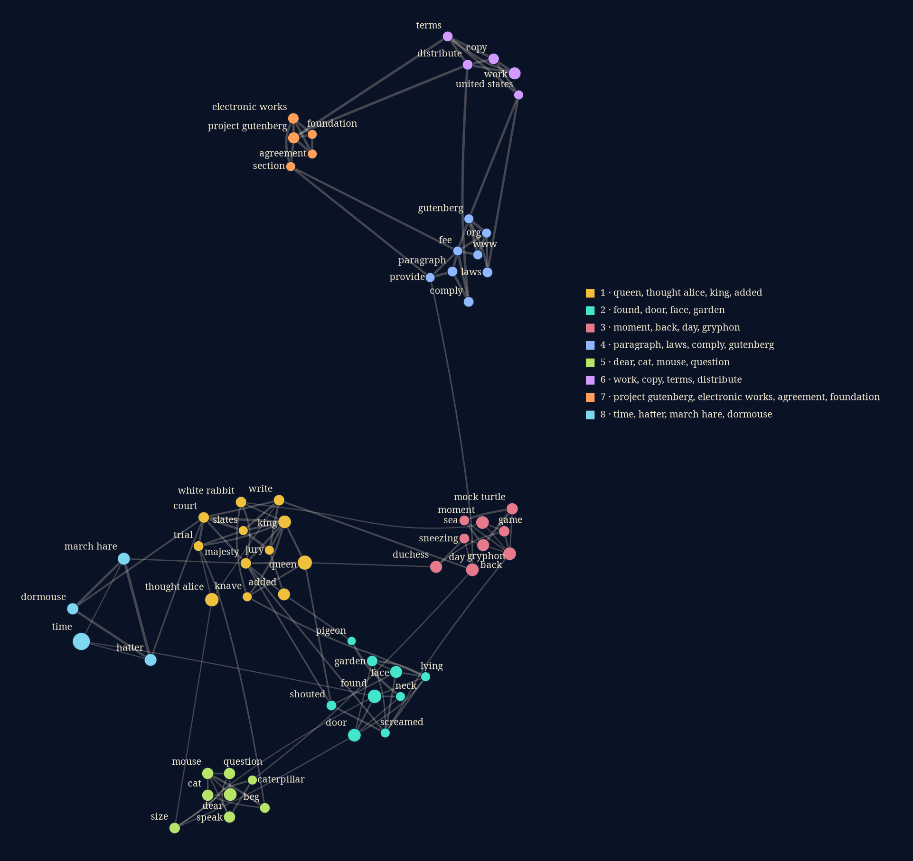
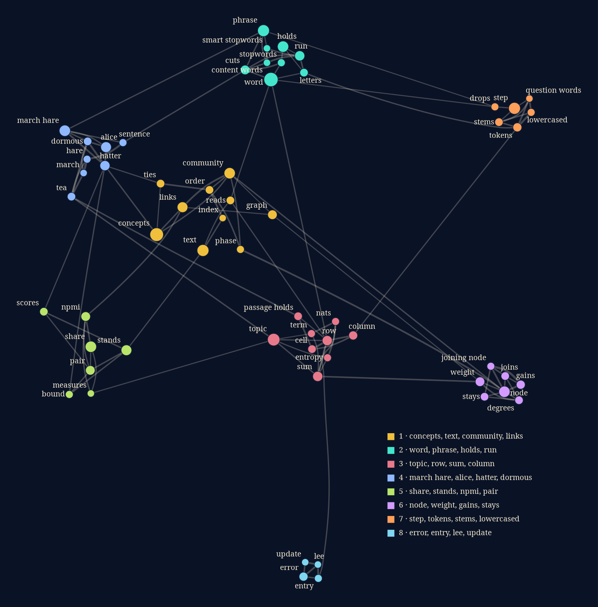

# concept-map

Maps a long text from its passages: the phrases it keeps returning to, which of them go together, and where each one appears.

A concept is a phrase from the text, such as "march hare". Concepts that share passages more often than chance are linked, and linked concepts form communities. Every concept and link lists the passages it comes from.

## Alice in Wonderland, mapped

The map of the Project Gutenberg EPUB of *Alice's Adventures in Wonderland*, in 166 passages. Each colour is a community, a circle grows with its concept's passages, and a line thickens with its NPMI. The trial, the tea party, the Gryphon and the Mock Turtle, and the Caterpillar each gather into a community, and the three communities at the top come from the Project Gutenberg licence that the book carries.



## How it works

`build` takes five steps:

1. **Phrases.** It cuts the text at stopwords and punctuation, so "the March Hare said" gives "march hare", and keeps the phrases of up to three words that appear in at least 3 passages and at most 30% of them.
2. **Topics.** It sorts the passages into topics by the words they use (non-negative matrix factorization of TF-IDF weights).
3. **Concepts.** It keeps the 60 phrases that best predict a passage's topic (by mutual information).
4. **Links.** Each concept picks up to three partners with which it shares far more passages than chance predicts, scored by normalized pointwise mutual information (NPMI): 1 for concepts always found together, 0 for chance. Either pick makes a link.
5. **Communities.** It groups the concepts that link more to each other than to the rest (the Louvain method).

[docs/concept-map.md](docs/concept-map.md) explains each step from the basics.

## Its own documentation, mapped

The map of [docs/concept-map.md](docs/concept-map.md), built from its 157 paragraphs and list items, with a community for each of its subjects: phrases, tokens and stems, the passage-by-word matrix, the *Alice* examples, NPMI, Louvain and NMF.



`cargo run --example docs_map | dot -Tpng -Gdpi=110 -o docs/concept-map.png` redraws it with Graphviz.

## Install

Add it from git; it needs Rust 1.92 or later.

```toml
[dependencies]
concept-map = { git = "https://github.com/AhmedKishki/concept-map" }
```

## Usage

```rust
fn main() -> Result<(), concept_map::Error> {
    // 24 passages in reading order. Each scene recurs in 6 of them, so its
    // phrases are frequent enough to be concepts and rare enough to tell
    // the scenes apart.
    let scenes = [
        "The Mock Turtle was crying, and the Gryphon danced the Lobster Quadrille.",
        "The Hatter and the March Hare were having tea with the Dormouse.",
        "The Queen of Hearts was at the trial of the Knave.",
        "Alice was down the rabbit hole, in a long hall.",
    ];
    let texts: Vec<&str> = (0..24).map(|i| scenes[i % 4]).collect();

    let map = concept_map::build(&texts)?;
    for community in &map.communities {
        let labels: Vec<&str> = community
            .concepts
            .iter()
            .map(|&id| map.concepts[id as usize].label.as_str())
            .collect();
        println!("{}", labels.join(", "));
    }
    let link = &map.links[0];
    println!(
        "{} and {}: NPMI {}, passages {:?}",
        map.concepts[link.a as usize].label,
        map.concepts[link.b as usize].label,
        link.npmi,
        link.passages
    );
    Ok(())
}
```

It prints

```text
crying, gryphon danced, lobster quadrille, mock turtle
dormouse, hatter, march hare, tea
hearts, knave, queen, trial
alice, long hall, rabbit hole
crying and gryphon danced: NPMI 1, passages [0, 4, 8, 12, 16, 20]
```

## Input

`build` takes the passages of one text in reading order, at least 20 of them; fewer return an `Error`. The settings were chosen for passages of whole paragraphs of at most 220 words. Pass the text you want mapped, leaving out notes, an index or licence text: `build` splits, lowercases and stems the words itself, and everything it receives counts. It reads English, with English stopword lists and an English stemmer.

## Output

`build` returns a `GraphResult`, which serde can serialize:

- `concepts`, each with its `label`, `passages` and `community`;
- `links`, each joining concepts `a` and `b`, with their `npmi` and shared `passages`;
- `communities`, each with its `concepts`, largest first;
- `passages` and `topics`, the number of each.

A passage's id is its index in your input, and a concept's id its index in `concepts`. `map.to_dot()` writes the map in Graphviz's DOT language, which `dot -Tpng` or `dot -Tsvg` draws as in the picture above.

## Cost

`build` runs on one thread. On an Intel Core Ultra 7 255H it took 0.07 s for 166 passages, 0.42 s for 650 and 4.3 s for 2,402.

## Similar tools

[VOSviewer](https://www.vosviewer.com/), a desktop application, and [InfraNodus](https://infranodus.com/), a web service, map a text's terms by co-occurrence and cluster them by modularity, and [GraphRAG](https://arxiv.org/abs/2404.16130) has a language model extract entities and group them. concept-map does this from the text alone, as a Rust library, and the same passages always give the same map.

## License

MIT. See [LICENSE](LICENSE).
