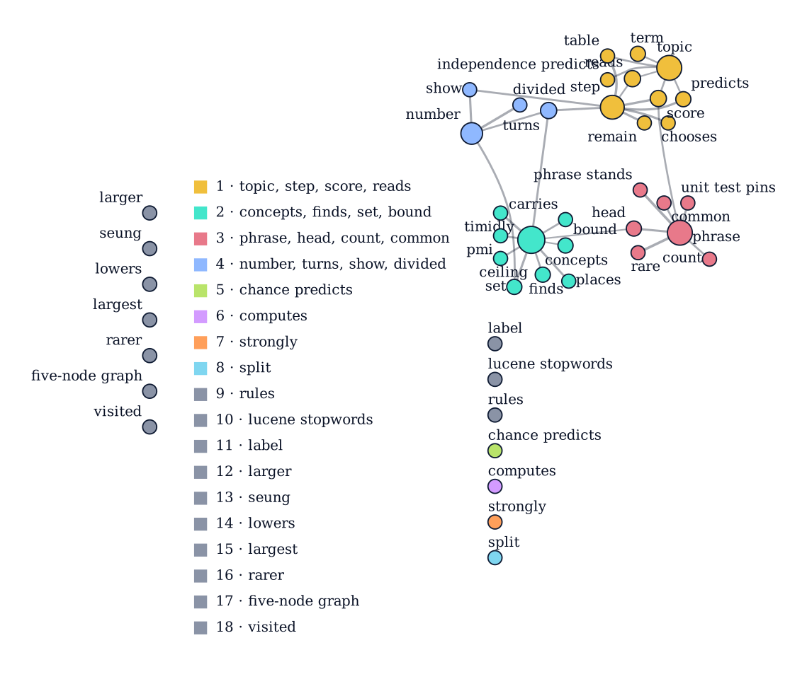

# concept-map documentation

[concept-map.md](concept-map.md) explains how concept-map builds a map from a text's passages: how it reads words, the five steps from candidate phrases to communities with the maths behind each, worked examples on *Alice in Wonderland*, how `to_dot` draws the result, and the limits of the method. [usage.md](usage.md) documents every public function and type of the crate, with recipes for common tasks.

## This documentation, mapped

The picture is concept-map's map of [concept-map.md](concept-map.md) itself, built from its 162 paragraphs and list items. Each colour is a community, a circle grows with its concept's passages, and a line thickens with its NPMI. The map is weak on this text: the document's own subjects, such as "NPMI", "Louvain" and "topic model", stand together too strongly to stay, so the map keeps words of the explanation instead. They fall into four linked communities, one around scoring and topics, one around choosing concepts, one around phrases and one around counting, and 14 concepts have no link at all and form communities of one.



[examples/docs_map.rs](../examples/docs_map.rs) takes the document's paragraphs and list items as passages, leaving out its headings, tables, code, formulas and references, and prints the map's `to_dot()`. From the root of the repository, with Graphviz installed, this command builds the map and draws it:

```sh
cargo run --example docs_map | dot -Tpng -Gdpi=110 -o docs/concept-map.png
```

The map is built from the document's own text, so an edit to concept-map.md changes it, and the same command brings the picture up to date.
