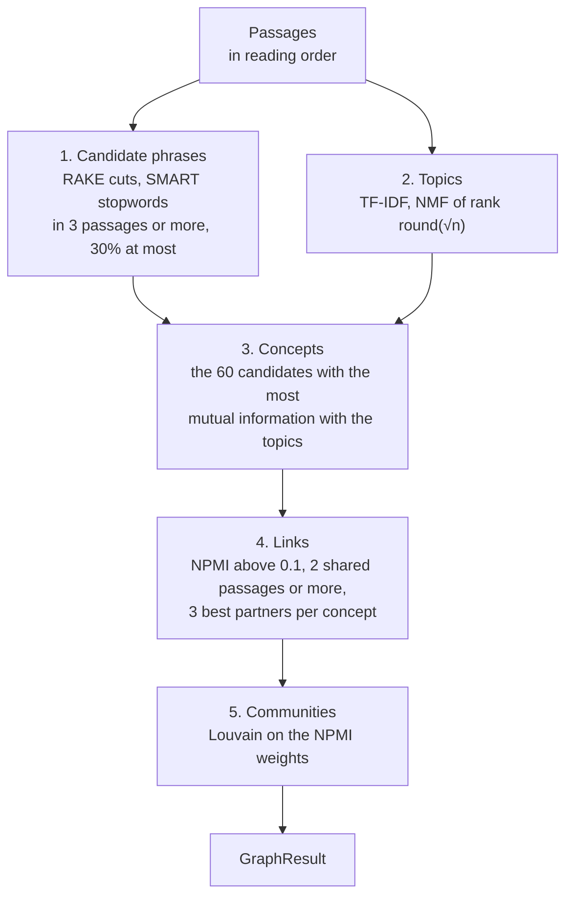
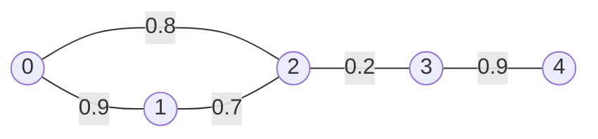

# The concept map

A concept map shows a text before you know what to search for in it: which subjects the text keeps returning to, which of them it treats together, and where in the text each one appears. It is built from the text's passages alone, with no model or training data.

A concept is a phrase from the text, such as "march hare". Two concepts are linked when they stand in the same passages more often than chance predicts. Linked concepts fall into communities. Every concept and every link carries the ids of its passages, so each one can be checked against the text.

## Overview

`build` in `src/lib.rs` turns the passages into a graph in five steps.

`build` takes the passages as a slice of texts in reading order. A passage's id is its index in that slice. Two concepts occur together when both stand in one passage, wherever they are inside it. The constants were chosen for passages of whole paragraphs of at most 220 words.

Below, n is the number of passages. `build` refuses an n below `GRAPH_MIN_BOOK_PASSAGES` = 20.

The worked examples use the Project Gutenberg EPUB of Lewis Carroll's *Alice's Adventures in Wonderland*, cut into 166 such passages without the chapter headings. Steps 2 and 3 add a toy text of six passages, small enough to show every number.

## Words, tokens and stems

A program cannot compare words until it has decided what a word is. Steps 1 and 2 decide it in three stages: they split the text into tokens, make tokens that differ only in form equal, and set apart the tokens that say nothing about a subject.

A **token** is a piece of text treated as one word. `src/analysis.rs` cuts the text at every character that is neither a letter nor a digit, so "Rabbit-Hole" gives the tokens "Rabbit" and "Hole".

**Lowercasing** makes "Hare" at the start of a sentence and "hare" inside one the same token.

**Stemming** maps the inflected forms of a word to one stem by removing suffixes. A stemmer applies an ordered list of suffix rules, many of them allowed only when enough of the word remains (Porter 1980). The crate uses the English Snowball stemmer, a revision of Porter's, from the `frostem` crate. It maps "remark", "remarks", "remarked" and "remarking" to "remark". A stem need not be a word, as "mouse" gives "mous"; it only has to be the same for the forms it gathers. Suffix rules cannot reach irregular forms, so "mice" keeps the stem "mice", apart from "mous".

**Stopwords** are words such as "the", "of" and "said" that occur in passages on every subject. A stopword list names them so that a program can drop them or, in step 1, cut phrases at them. The crate uses two lists: Lucene's 33 English stopwords for step 2 and the SMART system's 571 for step 1.

`src/analysis.rs` has two pipelines. Both tokenize, lowercase and stem as above.

- `KEY` drops nothing. Step 1 stems the words of its phrases with it, through `stem_word`, which stems a hyphenated word part by part and joins the parts with `-`.
- `STEMMED` drops Lucene's stopwords, nine question words (how, what, when, where, which, who, whom, whose, why) and tokens of `TOKEN_MAX_BYTES` = 40 bytes or more, such as an encoded blob. Step 2 counts the tokens that remain.

`STEMMED` turns "“Have some wine,” the March Hare said in an encouraging tone." into have, some, wine, march, hare, said, encourag, tone. "the", "in" and "an" are Lucene stopwords; "have", "some" and "said" are not, so they stay.

## Step 1: candidate phrases

A subject is often named by more than one word, such as "march hare". RAKE (Rose and others, 2010) finds such names without a grammar. Keywords often hold several words but rarely punctuation or stopwords, so RAKE cuts the text at every stopword and every punctuation mark and takes each run of words between two cuts as a candidate. RAKE then scores the candidates; the crate takes only the cut and leaves the choice to step 3.

`candidates` in `src/phrases.rs` lowercases the text and reads it word by word with its own reader, `words`, whose rules differ from the tokenizer's:

- A word is a run of letters that may hold `-`, `'` or `’` between two letters, so "labor-power" and "naïve" stay whole.
- A final possessive `'s` or `’s` is dropped, so "Kant’s" becomes "kant".
- A word that still holds an apostrophe, a contraction such as "doesn't", cuts the run.
- Any other character that is neither a letter nor whitespace cuts the run: punctuation, digits and symbols. Whitespace, line breaks included, only separates words.
- A word cuts the run when it is one of the 571 SMART stopwords in `src/smart_stopwords.txt` or has fewer than `MIN_WORD_LETTERS` = 3 letters.

The words that do not cut are content words. A run of 1 to `GRAPH_PHRASE_MAX_WORDS` = 3 content words is a phrase; a longer run is dropped whole, not split. Three sentences from *Alice* give these phrases:

| Sentence | Phrases |
|---|---|
| “Have some wine,” the March Hare said in an encouraging tone. | wine · march hare · encouraging tone |
| “Suppose we change the subject,” the March Hare interrupted, yawning. | suppose · change · subject · march hare interrupted · yawning |
| “It was the best butter,” the March Hare meekly replied. | butter |

"have", "some", "said", "we", "it", "was", "best", "the", "in" and "an" are SMART stopwords. In the second sentence nothing cuts between "Hare" and "interrupted", so the run is the three words "march hare interrupted". In the third, "march hare meekly replied" is a run of four content words, so it gives nothing.

A phrase is keyed by its words stemmed with `KEY` and joined by spaces, so "head" and "heads" are one phrase. Its label is the lowercased form it most often has, ties going to the form seen first.

A phrase stands in a passage only as a run of its own, so "march hare interrupted" adds nothing to "march hare", and "hatter" and "mad hatter" would be two concepts. A search for a concept's words can therefore find more passages than the concept has.

A phrase becomes a candidate when it stands in at least `GRAPH_CANDIDATE_MIN_PASSAGES` = 3 passages, so that it recurs, and in at most `GRAPH_CANDIDATE_MAX_SHARE` = 0.3 of them, so that it can still tell the parts of the text apart. Both limits count passages, not occurrences. Of the 2,716 distinct phrases in *Alice*, 581 become candidates. A text in which no phrase is a candidate gets an empty graph.

## Step 2: topics

Step 3 keeps the candidates that tell the parts of a text apart, so step 2 must first say what the parts are. `passage_topics` in `src/topics.rs` sorts the passages into k topics by the words they use, not by the candidates of step 1. k is `topic_count(n)`: the square root of n, rounded, and at least 2. The 166 passages of *Alice* give 13 topics. The result reports only their number, as `topics`.

### Passages as rows of numbers: TF-IDF

The vector-space model describes a passage by how much it uses each word. Give every word of the text a column and every passage a row; the cell in row i and column j says how strongly passage i uses word j. Passages about the same subject use the same words, so their rows have large numbers in the same columns.

The matrix built here, X, takes its words from the `STEMMED` tokens. A word gets a column when it is in at least `MIN_PASSAGES` = 2 passages, since a rarer word says nothing about topics, and in at most `MAX_SHARE` = 0.5 of them, since a more common word is in every topic. Columns are in the sorted order of their stems, so the same passages always give the same matrix. Below, v is the number of columns.

A cell holds

$$x = (1 + \ln \mathrm{tf}) \cdot \left( \ln \frac{1 + n}{1 + \mathrm{df}} + 1 \right)$$

where tf, the term frequency, is how often the word occurs in the passage and df, the document frequency, is how many passages hold it. A cell whose word is absent from the passage holds 0.

- The first factor grows with tf, but more slowly: it is 1 for one occurrence and 1.693 for two. A passage that repeats a word is about that word, but not twice as much for saying it twice.
- The second factor, the inverse document frequency (idf), is larger for a word in fewer passages, because a rare word says more about the passages that hold it than a common one.

Each row is then scaled to unit length: every cell of the row is divided by $\sqrt{\sum_j x_j^2}$, the row's length. A row's direction says which words a passage uses in which proportions, while its length grows with how many words the passage has. Unit length keeps the direction and discards the length, so a long passage does not outweigh a short one in the error that NMF lowers below.

**The toy text** has six passages, each a list of words:

| Passage | Text | `STEMMED` tokens |
|---|---|---|
| p0 | Alice, hatter, tea, tea. | alic, hatter, tea, tea |
| p1 | Hatter, dormouse. | hatter, dormous |
| p2 | Alice, tea, dormouse. | alic, tea, dormous |
| p3 | Alice, queen, croquet, croquet. | alic, queen, croquet, croquet |
| p4 | Queen, flamingo, tea. | queen, flamingo, tea |
| p5 | Alice, croquet, flamingo, garden. | alic, croquet, flamingo, garden |

"alic" is in 4 of the 6 passages, more than half, and "garden" is in 1, so neither gets a column. Of the six columns, "tea" is in 3 passages and gets the idf ln(7/4) + 1 = 1.5596; the other five are in 2 and get ln(7/3) + 1 = 1.8473. In p0, "hatter" weighs 1 × 1.8473 = 1.8473 and "tea", which occurs twice, 1.6931 × 1.5596 = 2.6407. The row's length is 3.2227, so after scaling "hatter" holds 0.573 and "tea" 0.819. The whole of X, with empty cells holding 0:

| | croquet | dormous | flamingo | hatter | queen | tea |
|---|---|---|---|---|---|---|
| p0 | | | | 0.573 | | 0.819 |
| p1 | | 0.707 | | 0.707 | | |
| p2 | | 0.764 | | | | 0.645 |
| p3 | 0.861 | | | | 0.509 | |
| p4 | | | 0.607 | | 0.607 | 0.513 |
| p5 | 0.707 | | 0.707 | | | |

In *Alice*, 1,308 words get a column, and only 5.4% of the cells of X are non-zero, so `tfidf` stores each row as `(column, weight)` pairs of its non-zero cells.

### Topics as a factorization: NMF

A matrix factorization writes one matrix as the product of two smaller ones. The product of W, with n rows and k columns, and H, with k rows and v columns, is the n × v matrix whose cell in row i and column j is

$$(WH)_{ij} = \sum_{t=1}^{k} W_{it} \, H_{tj}$$

Read W as passages by topics and H as topics by words. Row i of W says how much of each topic passage i has; row t of H says how much each word weighs in topic t. The formula then predicts passage i's weight for word j as the sum, over the topics, of how much of the topic the passage has times how much the word weighs in it.

$$\underbrace{X}_{n \times v} \;\approx\; \underbrace{W}_{n \times k} \; \underbrace{H}_{k \times v}$$

The rank of the factorization, k, is the number of topics. k is far smaller than v (13 against 1,308 in *Alice*), so WH can in general only approximate X. The factorization therefore chooses W and H to make the squared error small:

$$\lVert X - WH \rVert^2 = \sum_{i,j} \left( X_{ij} - (WH)_{ij} \right)^2$$

Non-negative matrix factorization (NMF) adds one condition: every entry of W and H is 0 or more. A product of non-negative factors can only add topics together, never subtract one from another, so each topic has to be a group of words that occur together, and each passage is approximated as a sum of such groups. Non-negativity thus makes the factors readable: a row of H is a list of words with weights, and a row of W is a list of topic shares. Lee and Seung (1999) show NMF learning such groups from encyclopedia articles.

### How `nmf` finds W and H

`nmf` lowers the error by Lee and Seung's multiplicative updates (2001), H first and then W in each iteration:

$$H \leftarrow H \circ \frac{W^\top X}{W^\top W H + \epsilon} \qquad W \leftarrow W \circ \frac{X H^\top}{W H H^\top + \epsilon}$$

$W^\top$ is W transposed, its rows turned into columns. The products $W^\top X$, $W^\top W H$, $X H^\top$ and $W H H^\top$ are ordinary matrix products, while $\circ$ and the fraction bar act entry by entry: each entry of H is multiplied by one ratio. `EPSILON` = 1e-10 keeps the ratio defined when a denominator is 0.

The update is a gradient step with a step size chosen per entry (Lee and Seung 2001, section 5). The gradient of the error with respect to H holds one slope per entry of H: how fast the error grows as that entry grows. For the squared error it is proportional to $W^\top W H - W^\top X$. An ordinary gradient step subtracts a small multiple η of it from H, which can push an entry below 0. Choosing $\eta = H / (W^\top W H)$ for each entry turns the step into

$$H - \frac{H}{W^\top W H} \circ \left( W^\top W H - W^\top X \right) = H \circ \frac{W^\top X}{W^\top W H}$$

which is the update above without ε. The same holds for W. The ratio compares, for each topic and word, what X holds with what WH reconstructs, both weighted by W. It is above 1 where the reconstruction falls short, so the entry grows, and below 1 where it overshoots, so the entry shrinks.

No entry turns negative: X, W and H hold no negative numbers, so every ratio is 0 or more, and multiplying an entry that is 0 or more by such a ratio leaves it 0 or more. The error never rises: Lee and Seung (2001, Theorem 1) prove that it is non-increasing under the updates without ε, but ε = 1e-10 changes a ratio noticeably only where the denominator is not much larger than 1e-10.

The error can have several local minima, points from which every small change raises it, so where the updates end depends on where they start. The start therefore comes from a SplitMix64 generator (Steele, Lea and Flood 2014) seeded with `NMF_SEED` = 1, whose sequence depends only on the seed, so every machine starts from the same W and H. Each entry is uniform on [0, 2√(x̄/k)), where x̄ is the mean cell of X with zeros included, so that WH starts with the same mean as X.

The loop runs at most `NMF_MAX_ITERATIONS` = 500 times. Every `CHECK_EVERY` = 10 iterations `loss` computes the error, and the loop stops when the error fell by less than `NMF_TOLERANCE` = 1e-4 of its value at the previous check. The first check only records the error, so the earliest stop is after 20 iterations.

A passage's topic is the column of its row of W with the largest value, ties going to the lower topic. A passage none of whose words has a column has a row of zeros in X; the first update sets its row of W to zeros, and the tie rule puts it in topic 0.

**The toy text** has k = 2. The error is 2.02639 at iteration 30 and 2.02635 at 40, a fall of 0.0000196 of the error at 30, below the tolerance, so the loop stops after 40 iterations with these factors (rounded to three decimals):

| | W: topic 0 | W: topic 1 | topic |
|---|---|---|---|
| p0 | 0.781 | 0.000 | 0 |
| p1 | 0.704 | 0.000 | 0 |
| p2 | 0.824 | 0.000 | 0 |
| p3 | 0.000 | 1.057 | 1 |
| p4 | 0.328 | 0.726 | 1 |
| p5 | 0.000 | 1.117 | 1 |

| H | croquet | dormous | flamingo | hatter | queen | tea |
|---|---|---|---|---|---|---|
| topic 0 | 0.000 | 0.596 | 0.052 | 0.500 | 0.063 | 0.699 |
| topic 1 | 0.588 | 0.000 | 0.421 | 0.000 | 0.333 | 0.071 |

Topic 0 is the tea party, with tea, dormous and hatter; topic 1 is the croquet game, with croquet, flamingo and queen. p4 mentions tea along with the queen and the flamingo, so it has some of both topics, but more of topic 1.

In *Alice*, topic 8 holds passages 80 to 89 and 132 to 134 and weighs hatter, dormous, march, hare and tea most: the tea party.

## Step 3: choosing concepts

`select` in `src/lib.rs` chooses the concepts among the candidates. Frequency alone would favour phrases spread evenly through the text, so `select` keeps the candidates that best predict a passage's topic. It measures how well a candidate predicts the topic by mutual information, which rests on entropy.

### Entropy

Information theory measures how uncertain an outcome is before you learn it. An outcome of probability p carries $-\ln p$ of information: a certain outcome carries none, and the rarer an outcome, the more learning it tells you. The entropy of a variable is the information its outcomes carry on average, in nats when the logarithm is natural, as here:

$$\mathrm{H}(G) = -\sum_{g} p(g) \ln p(g)$$

The entropy $\mathrm{H}(G)$ always names a variable in brackets, which tells it apart from the matrix H of step 2.

Let G say whether a passage holds a given phrase: 1 if it does, 0 if not. If the phrase stands in a share p of the passages, then

$$\mathrm{H}(G) = -p \ln p - (1 - p) \ln (1 - p)$$

This is largest, ln 2 = 0.693 nats, when p = 1/2, and small when the phrase is rare: "march hare", in 17 of the 166 passages of *Alice*, has $\mathrm{H}(G)$ = 0.330 nats, and a phrase in 3 of them 0.090.

### Mutual information

Let T be a passage's topic from step 2. The mutual information of T and G is how much knowing T lowers the uncertainty about G:

$$I(T;G) = \mathrm{H}(G) - \mathrm{H}(G \mid T)$$

where $\mathrm{H}(G \mid T)$ is the entropy that remains in G once the topic is known, averaged over the topics. `mutual_information` in `src/lib.rs` computes an equivalent form, with every probability a share of the n passages, that sums over every pair of a topic t and a value g:

$$I(T;G) = \sum_{t} \sum_{g \in \{0,1\}} p(t,g) \ln \frac{p(t,g)}{p(t)\,p(g)}$$

If T and G were independent, a passage of topic t would hold the phrase as often as any other passage, so $p(t,g)$ would equal $p(t)\,p(g)$. Each term compares the two: its logarithm is 0 when they are equal, positive when the pair (t, g) is more common than independence predicts, and negative when it is rarer. The sum is 0 when T and G are independent and positive otherwise. It can never exceed $\mathrm{H}(G)$, because $\mathrm{H}(G \mid T)$ cannot fall below 0. A term without passages counts as 0, the limit of $p \ln p$ as p falls to 0.

**A 2 × 2 table.** In the toy text, "tea" stands in p0, p2 and p4. Step 2 put p0, p1 and p2 in topic 0 and the rest in topic 1. The toy text is too small for the limits of step 1, but the score does not depend on them. Counting passages:

| | holds tea (g = 1) | lacks tea (g = 0) | all |
|---|---|---|---|
| topic 0 | 2 | 1 | 3 |
| topic 1 | 1 | 2 | 3 |
| all | 3 | 3 | 6 |

Every row and column share is 1/2, so independence predicts 1/4 of the passages in each cell. Each cell with 2 passages holds 1/3, a ratio of 1.3333, and its term is 0.3333 × ln 1.3333 = 0.3333 × 0.2877 = 0.0959. Each cell with 1 passage holds 1/6, a ratio of 0.6667, and its term is 0.1667 × (−0.4055) = −0.0676. The sum is 0.0566 nats. G has the largest entropy a yes-or-no variable can have, ln 2 = 0.693, but the topic removes less than a tenth of it, because tea is in both topics.

**"march hare" in *Alice*** has 12 of its 17 passages in topic 8 and one each in topics 3, 4, 6, 10 and 11. Its score is 0.200 nats, out of the 0.330 its entropy allows.

### What `select` keeps

The score is high for a phrase whose passages fall in few topics, but the bound $\mathrm{H}(G)$ keeps it low for a phrase in few passages, however concentrated: a phrase in 3 of the 166 passages can score at most 0.090.

The `GRAPH_CONCEPTS` = 60 highest scores become the concepts, ties going to the phrase in more passages, then to the lower key. In *Alice* "march hare" ranks 8th, and the 60th, "shouted", scores 0.079992. Below the cut, "thing" ranks 61st with 0.079985 although it stands in 38 passages, and "serpent" ranks 63rd with 0.0769 although its 3 passages all lie in topic 9, which holds only 4.

The concepts are then sorted by their first passage, ties by label, and numbered from 0 in that order.

## Step 4: links

`links` in `src/lib.rs` links concepts that share more passages than chance predicts. Chance here means independence. Normalized pointwise mutual information (NPMI) measures how far a pair of concepts departs from it.

### Pointwise mutual information

Let $d_a$ and $d_b$ be the numbers of passages concepts a and b stand in, and s the number both stand in. As shares of the n passages, $p(a) = d_a/n$, $p(b) = d_b/n$ and $p(a,b) = s/n$. If the two concepts were placed in passages independently, a passage would hold both with probability $p(a)\,p(b)$, so they would share $d_a d_b / n$ passages on average.

Pointwise mutual information (PMI), which Church and Hanks (1990) used to measure how strongly two words go together, is the logarithm of the observed share over the share independence predicts:

$$\mathrm{pmi}(a,b) = \ln \frac{p(a,b)}{p(a)\,p(b)} = \ln \frac{s\,n}{d_a\,d_b}$$

It is the logarithm in one term of the mutual-information sum of step 3, taken for a single pair of outcomes, hence "pointwise".

PMI favours rare pairs because of a bound. $p(a)$ and $p(b)$ are at least $p(a,b)$, so

$$\mathrm{pmi}(a,b) \le \ln \frac{p(a,b)}{p(a,b)\,p(a,b)} = -\ln p(a,b)$$

with equality when the two always stand together. The rarer the pair, the higher its bound. Two concepts in 3 of the 166 passages each that share 2 have a PMI of ln 36.9 = 3.61, while "hatter" and "march hare", which share 16, could reach no more than −ln(16/166) = 2.339 even if they always stood together.

### Normalized PMI

NPMI divides PMI by its bound (Bouma 2009):

$$\mathrm{npmi}(a,b) = \frac{\ln \dfrac{p(a,b)}{p(a)\,p(b)}}{-\ln p(a,b)} = \frac{\ln \dfrac{s\,n}{d_a\,d_b}}{-\ln \dfrac{s}{n}}$$

which `npmi` computes. Its values lie between −1 and 1, with fixed meanings:

- **1**: the two concepts only ever stand together, $s = d_a = d_b$, and PMI reaches its bound.
- **0**: they share as many passages as independence predicts, $s = d_a d_b / n$.
- **−1**: they never stand together. As s falls to 0, PMI falls without limit while the bound grows without limit, and their ratio tends to −1.

The code never meets the case of −1, because it scores only pairs that share at least 2 passages. The share limit of step 1 keeps the denominator above 0: both concepts stand in at most 0.3n passages, so s is at most 0.3n and the denominator is at least ln(1/0.3) = 1.204.

**A pair of concepts.** In *Alice*, "hatter" stands in 18 passages, "march hare" in 17, and they share 16. Independence predicts 18 × 17 / 166 = 1.84 shared passages, so they share 8.68 times as many. Their NPMI is

$$\frac{\ln (16 \cdot 166 / (18 \cdot 17))}{\ln (166 / 16)} = \frac{\ln 8.68}{\ln 10.38} = \frac{2.161}{2.339} = 0.924$$

A plain count of shared passages would mislead, because it grows with how common each concept is. "time" shares 8 passages with "hatter", half as many as "march hare" does, but "time" stands in 47, so chance alone predicts 47 · 18 / 166 ≈ 5.1 for the pair, and their NPMI is only 0.149. PMI errs the other way: the rare pair above has the higher PMI, 3.61 against 2.16, but an NPMI of 0.82, below the 0.92 of "hatter" and "march hare".

### Which pairs become links

Each concept keeps up to `GRAPH_PARTNERS` = 3 partners. The partners it can keep are the concepts that share at least `GRAPH_MIN_SHARED` = 2 passages with it and have an NPMI above `GRAPH_NPMI_FLOOR` = 0.1. Because NPMI's values have fixed meanings, this one floor serves every pair in every text. A concept keeps the partners with the highest NPMI, ties going to the lower id. A link exists when either concept keeps the other.

Seven concepts qualify as partners of "march hare". It keeps the three highest, "hatter" (0.924), "dormouse" (0.718) and "majesty" (0.244), and not "time" (0.168), the seventh. "time" keeps "found" (0.177), "march hare" (0.168) and "hatter" (0.149), so "time" and "march hare" are linked all the same. A concept that many others keep can therefore have more than three links: "king" has eight. *Alice* has 123 links among its 60 concepts.

The output rounds NPMI to three decimals, but step 5 uses the unrounded value.

## Step 5: communities

### Graphs

A graph is a set of nodes and a set of edges, each edge joining two nodes. Here the nodes are the concepts and the edges are the links. A link between a and b is the same as one between b and a, so the edges are undirected. Each edge carries a weight, the link's NPMI.

A weighted graph can be written as its adjacency matrix A, with a row and a column per node: $A_{ij}$ is the weight of the edge between i and j, 0 if there is none, and, as the edges are undirected, $A_{ij} = A_{ji}$. The degree $\mathrm{deg}_i$ of node i is the sum of the weights of its edges. m is the sum of all edge weights; every edge counts in the degrees of both its ends, so the degrees add up to 2m.

The example for this step is the five-node graph below: two groups joined by a weak edge, with NPMI-like values as weights.

Its degrees are 1.7, 1.6, 1.7, 1.1 and 0.9, so m = 3.5.

### Modularity

A community is a set of concepts more linked to each other than to the rest. Modularity (Newman and Girvan 2004) turns "more than" into a number by comparing the weight inside the communities with the weight chance would put there:

$$Q = \frac{1}{2m} \sum_{i,j} \left( A_{ij} - \frac{\mathrm{deg}_i \, \mathrm{deg}_j}{2m} \right) \delta(c_i, c_j)$$

Here $c_i$ is the community of node i, and $\delta(c_i, c_j)$ is 1 when i and j are in one community and 0 otherwise, so only pairs inside a community count. $\mathrm{deg}_i \mathrm{deg}_j / 2m$ is the weight that would join i and j if the same total weight were spread at random over the graph while every node kept its degree (Newman 2006). Each term is thus the weight observed between two nodes minus the weight expected.

Q rewards communities with more weight inside than their degrees predict. It does not reward putting everything together: with one community, the observed and the expected weights both add up to 2m, so Q is 0. For the five-node graph:

| Division | Q |
|---|---|
| every node alone | −0.211 |
| {0, 1, 2, 3, 4} | 0.000 |
| {0, 1}, {2, 3, 4} | 0.070 |
| {0, 1, 2}, {3, 4} | 0.351 |

The division along the weak edge scores highest.

### The Louvain method

The number of divisions grows faster than exponentially with the number of nodes, so `louvain` in `src/communities.rs` does not try them all. It finds a division with high modularity by the Louvain method of Blondel, Guillaume, Lambiotte and Lefebvre (2008), which alternates two phases.

**Phase 1, `move_nodes`.** Every node starts in a community of its own. The nodes are visited in index order, which at the first level is the order in which the text first mentions the concepts. A visited node i is taken out of its community. For that community and for each community C that i has a link into, the gain in modularity from putting i into C is

$$\Delta Q = \frac{A_{i,C}}{m} - \frac{\Sigma_C \, \mathrm{deg}_i}{2m^2}$$

where $A_{i,C}$ is the weight of i's links into C and $\Sigma_C$ is the sum of the degrees of the nodes in C, i excluded. The first part counts the weight i would bring inside C and the second the weight chance would put between i and C. The node joins the community with the largest gain, which may be the one it came from. Sweeps over all nodes repeat until a sweep moves no node.

Ties are broken the same way on every run. The node's own community starts as the best. The other communities are tried in the order of i's neighbours by index, and one replaces the best so far only when its gain is larger by more than `MIN_GAIN` = 1e-7. A tie therefore goes to the community found first, and rounding cannot make a node move back and forth.

In the five-node graph, node 0 is visited first. Taken out of its community it is alone, so staying alone gains 0. Joining node 1 gains

$$\frac{0.9}{3.5} - \frac{1.6 \times 1.7}{2 \times 3.5^2} = 0.146$$

and joining node 2 gains 0.111, so node 0 joins node 1. Modularity rises from −0.211 to −0.065, by exactly the gain. The rest of the first sweep runs as follows:

- Node 1 returns to {0, 1}, which gains 0.146, against 0.089 for joining node 2.
- Node 2 joins {0, 1}, which gains 0.200, against −0.019 for joining node 3.
- Node 3 joins node 4, which gains 0.217, against −0.167 for joining {0, 1, 2}.
- Node 4 has no other neighbour, so it returns to {3, 4}.

The second sweep moves no node, so phase 1 ends with {0, 1, 2} and {3, 4}.

**Phase 2, `aggregate`.** Each community becomes one node. The links between two communities add up to one link, and the links inside a community become a self-loop holding twice their weight, as the adjacency matrix would. Each new node's degree is therefore the sum of its members' degrees, and m stays as it was. In the example, {0, 1, 2} becomes a node with a self-loop of 4.8, {3, 4} a node with a self-loop of 1.8, and the two are joined by 0.2.

Phase 1 then runs on the smaller graph, where moving a node moves a whole community. `move_nodes` numbers the communities from 0 in order of first appearance, so the nodes of the next level are again visited in a fixed order. The two phases repeat, with no limit on the number of passes, until a phase 1 moves no node. In the example, moving either new node into the other's community gains −0.351, so nothing moves and the method stops with {0, 1, 2} and {3, 4}, Q = 0.351.

A concept without links stays a community of its own.

`build` orders the communities largest first, ties going to the community whose first concept the text mentions earlier, and numbers them in that order. *Alice* has 8 communities, one of them "time", "hatter", "march hare" and "dormouse". Because modularity weighs links against what the concepts' degrees predict, a concept with many links does not draw every concept it touches into its community: "queen" is linked to "shouted" and "duchess", yet both belong to other communities.

## Limits

- The method is for English: the SMART stopwords, Lucene's stopwords, the question words and the stemmer are English.
- A graph has at most 60 concepts, however long the text. In a long text more subjects compete for the 60 places, so a subject whose phrases score lower is left out however often it occurs.
- A phrase is any run of up to three content words, not a noun phrase. In *Alice* "thought alice" is a concept, because "said" is a SMART stopword and "thought" is not.
- A name that holds a stopword, a digit or a word of fewer than three letters is split or lost: "queen of hearts" gives "queen" and "hearts".
- The 30% limit can remove a text's most frequent subject. In *Alice* "alice" stands alone in 105 of the 166 passages, where the limit allows 49, so the heroine is not a concept.
- Pronouns and synonyms add nothing to a concept's passages.
- Line breaks do not cut a phrase, so a heading, paragraph or list item that ends without punctuation runs into the first words of whatever follows it in the passage.
- A link says only that two concepts share passages more often than chance predicts. It has no direction or kind.
- The concepts are chosen by the topics, which give each passage exactly one topic, so a different factorization would choose different concepts.
- Louvain returns a local optimum of modularity, the one its fixed visiting order reaches.
- The graph filters nothing, so notes, an index, running heads and licence text count like the body of the text; a caller who wants them left out removes them from the passages before calling `build`. The Project Gutenberg header and licence of *Alice* (passage 0 and passages 149 to 165) form a topic of their own and give concepts such as "project gutenberg", "electronic works", "www", "gutenberg" and "org". Three of the eight communities consist mostly of these concepts. "www", "gutenberg" and "org" are linked with an NPMI of 1, because the dots of www.gutenberg.org cut it into three phrases that always stand together.

## References

- Vincent D. Blondel, Jean-Loup Guillaume, Renaud Lambiotte and Etienne Lefebvre. "Fast unfolding of communities in large networks". *Journal of Statistical Mechanics: Theory and Experiment* (2008), P10008. Free at <https://arxiv.org/abs/0803.0476>. The Louvain method: section 2 describes its two phases and the gain in modularity from moving a node.
- Gerlof Bouma. "Normalized (Pointwise) Mutual Information in Collocation Extraction". In *From Form to Meaning: Processing Texts Automatically, Proceedings of the Biennial GSCL Conference 2009*, Gunter Narr, 2009, pp. 31–40. Free draft at <https://svn.spraakdata.gu.se/repos/gerlof/pub/www/Docs/npmi-pfd.pdf>. Section 3.1 defines NPMI and its values at −1, 0 and 1.
- Kenneth Ward Church and Patrick Hanks. "Word Association Norms, Mutual Information, and Lexicography". *Computational Linguistics* 16(1), 1990, pp. 22–29. Free at <https://aclanthology.org/J90-1003/>. PMI as a measure of how strongly two words go together.
- Daniel D. Lee and H. Sebastian Seung. "Learning the parts of objects by non-negative matrix factorization". *Nature* 401 (1999), pp. 788–791. NMF, and why non-negativity yields parts.
- Daniel D. Lee and H. Sebastian Seung. "Algorithms for Non-negative Matrix Factorization". In *Advances in Neural Information Processing Systems 13* (NIPS 2000), MIT Press, 2001, pp. 556–562. Free at <https://proceedings.neurips.cc/paper/2000/hash/f9d1152547c0bde01830b7e8bd60024c-Abstract.html>. Section 4 states the multiplicative updates with Theorem 1, that the squared error is non-increasing; section 5 derives them as gradient steps with a step size per entry; section 6 proves the theorem.
- Mark E. J. Newman. "Modularity and community structure in networks". *Proceedings of the National Academy of Sciences* 103(23) (2006), pp. 8577–8582. Free at <https://arxiv.org/abs/physics/0602124>. Modularity written with the adjacency matrix, and the expected weight $\mathrm{deg}_i \mathrm{deg}_j / 2m$ of the random graph it compares with.
- Mark E. J. Newman and Michelle Girvan. "Finding and evaluating community structure in networks". *Physical Review E* 69 (2004), 026113. Free at <https://arxiv.org/abs/cond-mat/0308217>. Section IV defines modularity.
- M. F. Porter. "An algorithm for suffix stripping". *Program* 14(3), 1980, pp. 130–137. Free at <https://tartarus.org/martin/PorterStemmer/def.txt>. The original stemmer: suffix rules applied in steps, most with a condition on what remains of the word.
- Stuart Rose, Dave Engel, Nick Cramer and Wendy Cowley. "Automatic Keyword Extraction from Individual Documents". In Michael W. Berry and Jacob Kogan (eds.), *Text Mining: Applications and Theory*, John Wiley & Sons, 2010, pp. 1–20. RAKE. Section 1.2.1, "Candidate keywords", describes the cut at stopwords and phrase delimiters that step 1 takes.
- Guy L. Steele Jr., Doug Lea and Christine H. Flood. "Fast Splittable Pseudorandom Number Generators". In *Proceedings of the 2014 ACM International Conference on Object Oriented Programming Systems Languages & Applications* (OOPSLA 2014), ACM, 2014, pp. 453–472. SplitMix64, the generator that starts NMF.

## Further reading

- Albert-László Barabási. *Network Science*. Cambridge University Press, 2016. Free at <http://networksciencebook.com>. Chapter 2 covers degree (2.3), the adjacency matrix (2.4) and weighted networks (2.6); chapter 9 covers modularity (9.4) and the Louvain algorithm (9.12, Advanced Topic 9.C).
- David J. C. MacKay. *Information Theory, Inference, and Learning Algorithms*. Cambridge University Press, 2003. Free at <https://www.inference.org.uk/itila/book.html>. Section 2.4 defines information content and entropy; section 8.1 defines conditional entropy and mutual information.
- Christopher D. Manning, Prabhakar Raghavan and Hinrich Schütze. *Introduction to Information Retrieval*. Cambridge University Press, 2008. Free at <https://nlp.stanford.edu/IR-book/>. Section 2.2 covers tokenization, stop words, case folding and stemming. Chapter 6 builds the vector-space model: term frequency and idf (6.2.1, 6.2.2), documents as vectors and length normalization (6.3), and the $1 + \log \mathrm{tf}$ damping of step 2 (6.4.1). Section 18.1 reviews matrices and their products.
- "The English (Porter2) stemming algorithm". Snowball, <https://snowballstem.org/algorithms/english/stemmer.html>. The rules of the English Snowball stemmer that `frostem` compiles, for working out why a word gets the stem it gets.
